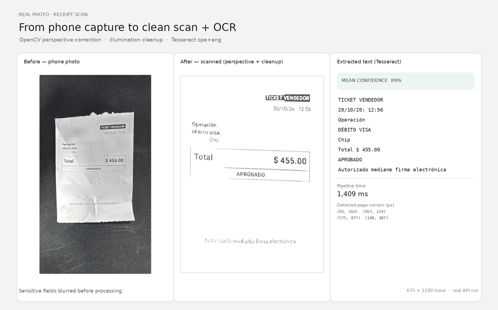
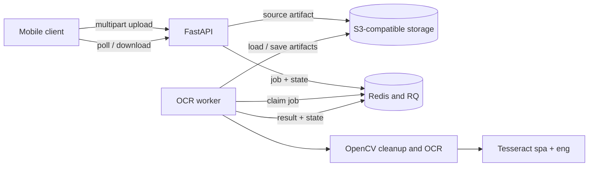
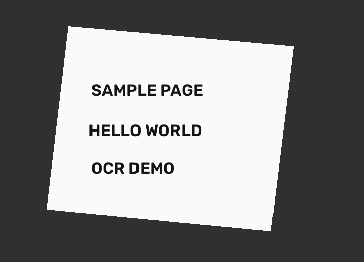

# DocScan API

A small, production-minded asynchronous scanner for mobile capture flows. It accepts a document image, rectifies the page, runs OCR in a separate worker, and exposes a stable versioned JSON result contract.

Repository: [github.com/JEHH97/docscan-api](https://github.com/JEHH97/docscan-api)

## Real phone-photo example

This approved, redacted receipt photo demonstrates page detection, perspective correction, scanner-style cleanup, and Tesseract output from a real API run. Sensitive fields were blurred before processing.



## Problem

Mobile clients need to submit large camera images without holding an HTTP request open for image cleanup and OCR. This service validates uploads up front, returns a job identifier quickly, and makes state and structured OCR output available through predictable versioned endpoints.

## Architecture



## Stack

- Python 3.12, FastAPI, Pydantic v2, and an exported OpenAPI 3 contract.
- Redis plus RQ for queued, processing, done, and failed jobs.
- OpenCV for multi-strategy page quadrilateral detection, perspective correction, scanner-style illumination flattening, and OCR variants; Tesseract for OCR.
- A storage interface with local disk and boto3 S3-compatible adapters. The Compose stack uses MinIO.
- pytest, Ruff, mypy, Docker Compose, and GitHub Actions.

## Technical decisions

- The API returns `202 Accepted` immediately; OCR runs in its own process and result state is persisted in Redis with a configurable TTL.
- API schemas contain only stable, typed public fields: state, text, confidence, word boxes, source page corners, and per-stage timings.
- Page detection scores page-color segmentation and edge-based quadrilaterals by size and shape, with a robust rectangle fit for ragged edges; it safely falls back to the full frame only when no candidate passes. The returned PNG defaults to an upscaled, text-aware scan-style grayscale: illumination and crease shading are flattened, paper outside recognized text and long rules becomes white, and antialiased strokes are retained. Set `OUTPUT_MODE=photo` to keep the warped color photo instead. Detection area bounds, OCR minimum height, Tesseract page segmentation mode, scan output height, and trim ratio can be configured with `DOCSCAN_MIN_DOCUMENT_AREA_RATIO`, `DOCSCAN_MAX_DOCUMENT_AREA_RATIO`, `DOCSCAN_OCR_MIN_HEIGHT`, `DOCSCAN_OCR_PSM`, `DOCSCAN_SCAN_MIN_HEIGHT`, and `DOCSCAN_SCAN_TRIM_RATIO`. Uploads are constrained by byte limit, MIME signature, and image decoder validation.
- Storage, queueing, and API layers are separate. Local disk supports development; boto3 supports S3-compatible deployment without changing the processing flow.
- Optional callbacks are checked at submission and delivery time to reject private or non-global network destinations. Redirects are disabled.
- An optional API key, per-client Redis rate limit, configurable CORS allowlist, structured JSON logs, and non-sensitive failure messages provide basic operational safeguards.

## Run locally

Docker Compose starts the API, independent worker, Redis, and MinIO with a demo bucket created on first use:

```bash
docker compose up --build
```

The API is at `http://localhost:8000`; interactive docs are at `/docs`; MinIO console is at `http://localhost:9003` (demo credentials are supplied by Compose defaults). Use an `.env` file to configure limits, CORS, or an API key. The checked-in `.env.example` contains placeholders only.

Submit an image and poll the returned `status_url`:

```bash
curl -F 'file=@docs/example-before.png;type=image/png' http://localhost:8000/v1/scans
curl http://localhost:8000/v1/scans/<job-id>
curl -o corrected.png http://localhost:8000/v1/scans/<job-id>/image
```

To stop and remove the local stack and data volumes:

```bash
docker compose down -v
```

## API endpoints

| Method | Path | Purpose |
| --- | --- | --- |
| `POST` | `/v1/scans` | Upload JPEG, PNG, or WebP as multipart form data; returns `202` with an id and links. Optional `callback_url` is also multipart form data. |
| `GET` | `/v1/scans/{id}` | Return current state and, on completion, OCR text, mean confidence, word boxes, page corners, and timings. |
| `GET` | `/v1/scans/{id}/image` | Download the corrected PNG after successful processing. |
| `GET` | `/healthz` | Readiness check including Redis connectivity. |

Send `X-API-Key` when `API_KEY` is configured. `GET /openapi.json` serves the live API contract.

## Synthetic example

The sample below is generated for this repository and contains only fictional sample text.

| Before | Corrected |
| --- | --- |
|  |  |

## Tests and checks

Install Python 3.12 and Tesseract with English and Spanish language data, then run:

```bash
python -m venv .venv && . .venv/bin/activate
pip install --require-hashes -r requirements.lock
pip install --no-deps -e .
make check
```

`make check` runs Ruff lint and formatting checks, strict mypy, pytest with a 70% coverage floor over the domain and image pipeline, and a repository-content guard. Pipeline tests use synthetic rotated pages, mock OCR for deterministic box/metadata coverage, and also run Tesseract against printed sample words; the API integration test completes a job synchronously against an in-memory Redis instance.

## Demo

Demo: _coming soon_

For container images and the public Docker deployment, see [DEPLOY-DOCKER.md](DEPLOY-DOCKER.md).

## License

MIT. See [LICENSE](LICENSE).
